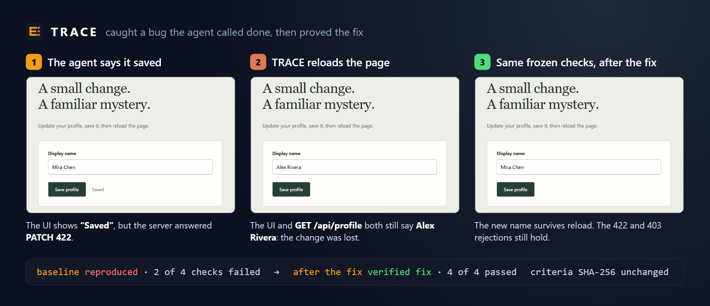

<p align="center">
  <picture>
    <source media="(prefers-color-scheme: dark)" srcset="assets/logo-dark.svg">
    
  </picture>
</p>

<h1 align="center">TRACE</h1>

<p align="center">
  <em>Your agent builds it. TRACE checks it.</em>
</p>

<p align="center">
  <a href="https://github.com/kg290/trace/actions/workflows/ci.yml"></a>
  <a href="https://github.com/kg290/trace/releases/latest"></a>
  <a href="#install"></a>
  <a href="https://github.com/kg290/trace/stargazers"></a>
  <a href="LICENSE"></a>
</p>

<p align="center">
  
</p>

<p align="center">
  <strong>Stop being the tester for code your AI wrote.</strong><br>
  TRACE runs the software, shows you the evidence, and proves the fix with the same checks that failed.<br>
  <sub>A plugin for Claude Code and Codex. No API keys, no telemetry. Real screenshots from the <a href="docs/DEMO.md">seeded demo</a>.</sub>
</p>

<p align="center">
  <a href="#install">Install</a> &middot;
  <a href="#how-it-works">How it works</a> &middot;
  <a href="#what-it-checks">What it checks</a> &middot;
  <a href="#proving-a-fix">Proving a fix</a> &middot;
  <a href="#faq">FAQ</a> &middot;
  <a href="ROADMAP.md">Roadmap</a>
</p>

---

## Why

You ask for a feature. The agent says it's done. You open the app, click around, find it broken, take a screenshot, paste the logs, and type *"it still doesn't work"* for the fifth time.

TRACE does that part. Type `/trace` and it picks what to check from your request, the diff, the docs and the tests. It runs the software, collects the evidence, and hands your agent a compact finding instead of a wall of logs. When the agent fixes something, TRACE re-runs the **same frozen check that failed**. A pass that never failed doesn't count.

## Install

**Claude Code**, as two separate prompts:

```
/plugin marketplace add kg290/trace
```
```
/plugin install trace@trace
```

**Codex:**

```bash
codex plugin marketplace add kg290/trace
codex plugin add trace@trace
```

Then open `/hooks` in Codex, trust TRACE's Stop hook, and start a new thread.

**Any other agent**, or a single project without a plugin: `node install.mjs --project <path>` from a clone. Step by step, including the optional local helper: **[INSTALL.md](INSTALL.md)**.

Only install TRACE from [`kg290/trace`](https://github.com/kg290/trace) on GitHub.

## Use it

| You type | What happens |
| --- | --- |
| `/trace` | Checks the project, starting with what you just worked on |
| `/trace check the feature you just built` | The normal path, an edge case, error handling, and the parts the change touches |
| `/trace verify this fix` | Re-runs the frozen failing scenario, plus regression checks |
| `/trace check the login page` | Only that area |

The plugin skill lives under its plugin's name: **`/trace:trace`** in Claude Code (typing `/trace` finds it) and **`$trace:trace`** in Codex (or pick TRACE under `@`). A check-only request reports findings and changes no code. If the task includes fixing, your agent fixes and TRACE proves it.

## How it works

1. **Scope.** It reads your request, the recent diff, the README, manifests, existing tests and documented examples. Uncommitted work is left alone.
2. **Choose.** It picks at most six scenarios: the normal path, an edge or error case, the parts the change touches, and regressions. Every expectation needs a source. A guess becomes **needs review**, never a bug.
3. **Run.** It uses your agent's own browser, terminal and test tools first. An optional local helper adds exact, repeatable browser, HTTP, CLI and library checks.
4. **Report.** Each finding gives what was checked, what was expected (and from where), what actually happened, how to reproduce it, and the evidence. Duplicates are grouped and ranked by impact.
5. **Prove.** Before a fix, the checks are frozen and hashed. Afterwards, the same scenario runs again, with regression checks around it.

## What it checks

| Project | What TRACE does | Evidence |
| --- | --- | --- |
| **Web apps** | Explores screens, fills forms, clicks, reloads, reads saved state | Screenshots, visible messages, HTTP statuses, console and runtime errors, layout measurements |
| **APIs** | Calls endpoints, then reads back to confirm the write | Exact status and JSON, request and response |
| **CLIs and scripts** | Runs representative commands | Exit code, stdout/stderr, generated files (a stale file can't pass) |
| **Libraries** | Calls public functions with representative inputs | Return values or the expected error, async included |
| **Desktop and mobile** | Only through a real driver your host provides | Otherwise **unsupported**, never faked |

The helper runs Node projects directly. Python, Go, Rust and the rest go through your agent's terminal and your own test suite.

## A finding

```text
✗ CONFIRMED DEFECT · Profile change is lost after saving

  Checked     Save "Mira Chen" as display name, then reload
  Expected    Name persists after reload       (source: examples/profile/README.md)
  Observed    UI shows "Saved", PATCH /api/profile → 422, reload shows "Alex Rivera"
  Reproduce   fill "Display name" → click "Save profile" → reload
  Evidence    3 screenshots · response status · persisted value
  Cause       (suspected) client sends `display_name` instead of `displayName`
              and ignores the error response

Coverage: 4 checks · 2 failed (UI + API, grouped as 1 defect) · 2 passed (422 + 403 rejections)
```

Facts stay separate from suspected causes. A visual difference, a 4xx response or exit code 0 is, on its own, neither a pass nor a defect.

## Proving a fix

| Result | Meaning |
| --- | --- |
| `reproduced` | The baseline shows the bug |
| `verified fix` | The baseline failed, and the same frozen checks now pass |
| `could not reproduce` | It passes, but it never failed. **Not** a fix. |
| `still failing` | The fix didn't work |
| `regression` | It passed before and fails now |
| `blocked` · `unsupported` · `needs review` | Couldn't run, no integration, or no clear expectation |

Changed criteria are refused. Every verify run keeps a screenshot for before and after, and failed checks record what was actually seen. Each result also counts the runs and the time from the failing baseline to the verified fix: measured numbers, not promises.

## Automatic checks

At the end of a task that changed code, TRACE checks that change once before the agent hands back. It never runs mid-task, never asks twice in a row, and stays silent when nothing changed.

| | |
| --- | --- |
| **Claude Code** | On with the plugin. Turn it off in `/config` → TRACE → *Automatic checks* |
| **Codex** | Runs once you trust the hook in `/hooks` |
| **One project off** | `{"autoCheck": false}` in that project's `.trace.json` |
| **Everywhere off** | `TRACE_AUTO_CHECK=0` |

## Safe by default

- **Asks first.** "Check my project" never covers payments, outside messages, destructive commands or production.
- **Local only.** The helper's browser talks only to your local app. Other sites, WebSockets and service workers are blocked.
- **Private stays private.** Password, token, email and card fields are masked in screenshots. Secrets are removed from text. Cookies, headers, storage and request bodies are never kept.
- **Your files are safe.** Evidence lives outside your project. The installer never overwrites anything.
- **Nothing leaves your machine** because of TRACE: no telemetry, no uploads, no model calls.

More in [PRIVACY](docs/PRIVACY.md) and [SECURITY](SECURITY.md).

## FAQ

**Does it replace my coding agent?**
No. It runs inside the agent you already use. TRACE does the checking, and your agent does the fixing.

**Do I need an API key or a browser download?**
No. The skill uses your agent's existing tools. Only the optional helper needs Playwright's Chromium, and only for its own browser checks.

**Does it save tokens?**
We don't claim that. TRACE records runs and time-to-verified-fix per bug, so you can see for yourself. Checking costs tool calls too.

**Can it break my data?**
Read-only checks are the default. Writing test data takes an explicit permission and should use synthetic data. Project code that TRACE runs is **not** sandboxed, so only check code you trust.

**If TRACE passes, is my app bug-free?**
No, and TRACE never says so. It reports exactly what it covered, what passed, and what stayed untested.

**Why "experimental"?**
The core flows are tested on Windows with Claude Code and Codex, and CI runs Windows and Ubuntu. macOS and desktop/mobile drivers aren't covered yet. See the [validation ledger](docs/VALIDATION.md) and the [roadmap](ROADMAP.md).

## Documentation

| | |
| --- | --- |
| [INSTALL](INSTALL.md) | Every way to install, the local helper, updating and removing |
| [Demo](docs/DEMO.md) | The save that didn't save, caught and verified |
| [Helper CLI](docs/CLI.md) | Commands, statuses, exit codes, permission flags |
| [Architecture](docs/ARCHITECTURE.md) | How the skill, plugins, hook and helper fit together |
| [Privacy](docs/PRIVACY.md) | What is collected, masked, stored and never touched |
| [Validation](docs/VALIDATION.md) | What has been tested, and what hasn't |
| [Design decisions](docs/RESEARCH.md) | Why TRACE is built this way |
| [Roadmap](ROADMAP.md) | What's next |

## Contributing

Bug reports, wrong findings and new integrations are welcome. Read [CONTRIBUTING](CONTRIBUTING.md) first, and report vulnerabilities privately ([SECURITY](SECURITY.md)). Release notes are in the [CHANGELOG](CHANGELOG.md).

## License

[MIT](LICENSE). Check it, fork it, ship it.
