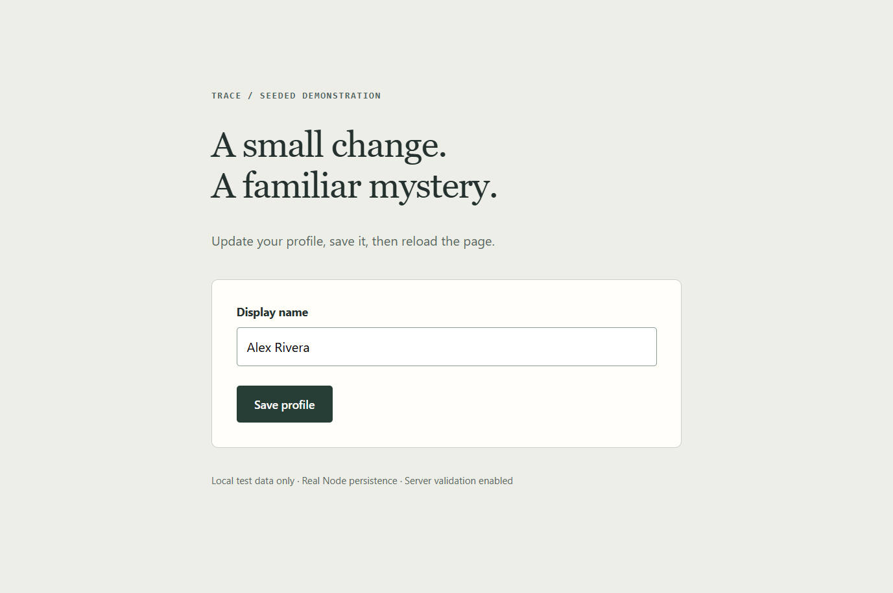
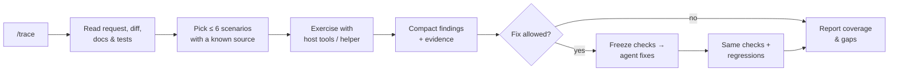

<div align="center">


# TRACE

### Your agent builds it. TRACE checks it.

Stop manually checking and explaining everything your AI builds.<br/>
TRACE exercises the software, shows evidence of problems, and proves that the fixes work.

[](CHANGELOG.md)
[](LICENSE)
[](.node-version)
[](#-claude-code)
[](#-codex)
[](docs/VALIDATION.md)

[**Quick start**](#-quick-start) · [**What it checks**](#-what-it-checks) · [**Proving fixes**](#-proving-a-fix-not-just-a-pass) · [**FAQ**](#-faq) · [**Docs**](#-documentation)

</div>

<br/>

| ① The agent says it's done | ② TRACE reloads: the change is gone | ③ After the fix: verified |
| :---: | :---: | :---: |
|  |  |  |
| UI says **Saved**, but the server answered **422** | Same scenario, checked after reload | Same frozen checks pass, and the 422/403 rejections still hold |

<sub>Real screenshots from the seeded <a href="docs/DEMO.md">profile demo</a>. Synthetic data only.</sub>

---

## 💡 Why TRACE

Coding agents are fast at writing code and bad at noticing that it doesn't work. Usually *you* end up as the tester. You click through the app, take screenshots, copy logs, and type "it still doesn't work" for the fifth time.

TRACE takes over that loop. **Type `/trace`. Nothing else is required.**

- 🧭 **Picks what to check.** It reads your request, the recent diff, docs and existing tests, then runs a small set of meaningful scenarios.
- 🖱️ **Actually runs the software.** It clicks through web UIs, calls APIs, runs CLIs and calls library functions.
- 📸 **Collects the evidence for you.** You get screenshots, failing inputs, HTTP statuses, console errors, stack traces and layout measurements, all captured automatically.
- 🧾 **Reports what matters.** Each finding says what was checked, what was expected and why, what happened, how to reproduce it, and the evidence.
- ✅ **Proves the fix.** The original check is frozen before the fix. A fix is "verified" only when that same check failed first and passes afterwards.
- 🔌 **Works with the agent you already use.** TRACE is a plugin for Claude Code and Codex, not another agent or service. It needs no API keys and sends no telemetry.

## 🚀 Quick start

TRACE installs as a **plugin** in Claude Code and Codex. One install covers every project.

<a id="-claude-code"></a>

### 🟠 Claude Code

```text
/plugin marketplace add kg290/Trace
/plugin install trace@trace
```

On Claude Code 2.1.275+ this works as a single command: `/plugin install trace --marketplace kg290/Trace`. From a terminal, use `claude plugin marketplace add kg290/Trace` and then `claude plugin install trace@trace`.

Then, in any project:

```text
/trace
```

It appears as **`/trace:trace`** in the picker, because plugin skills carry their plugin's name.

<a id="-codex"></a>

### ⚫ Codex

```sh
codex plugin marketplace add kg290/Trace
```

Open **`/plugins`**, install **TRACE**, and start a new session. Type **`$trace`**, or pick TRACE under **`@`**. Codex asks you to review TRACE's hook once; approve it to enable [automatic checks](#automatic-checks).

### What you get

| | Claude Code | Codex |
| --- | :---: | :---: |
| `/trace` · `$trace` skill, no arguments needed | ✅ | ✅ |
| Automatic check at the end of a task that changed code | ✅ on by default | ✅ after you approve the hook |
| Toggle automatic checks in settings | ✅ `/config` → TRACE | ✅ hook trust |
| Starter prompts and icon in the plugin browser | ✅ | ✅ |

A bare `/trace` means *"check this project, starting with what we just worked on."*

<details>
<summary><b>📁 Install into one project instead (no plugin)</b></summary>

<br/>

Requires Node.js 22.23+ or 24. This copies a skill folder and nothing else: no npm install, no browser download, no global changes.

```sh
git clone https://github.com/kg290/Trace.git && cd Trace
node install.mjs --project /path/to/project                          # both hosts
node install.mjs --project /path/to/project --agent claude --auto-check
node install.mjs --project /path/to/project --uninstall
```

The installer never overwrites. It refuses to install over an existing skill and refuses to remove files you edited. Use either the plugin or this installer, not both, or you'll see TRACE twice.

</details>

<details>
<summary><b>🔄 Update or remove the plugin</b></summary>

<br/>

| | Claude Code | Codex |
| --- | --- | --- |
| Update | `/plugin marketplace update trace` | `codex plugin marketplace upgrade trace` |
| Remove | `/plugin uninstall trace@trace` | Uninstall in `/plugins`, then `codex plugin marketplace remove trace` |

</details>


## 🗣️ Just say what you want

| You type | TRACE does |
| --- | --- |
| `/trace` | Checks the project, starting with the feature from this conversation |
| `/trace check the feature you just built` | Runs the normal path, an edge case, error handling and the parts it touches |
| `/trace verify this fix` | Re-runs the frozen failing scenario plus regression checks |
| `/trace check the login page` | Checks only that area |

If you only asked for a check, TRACE reports findings and changes no code. If the task includes fixing, your agent fixes the code and TRACE re-checks the original expectation.

<a id="automatic-checks"></a>

## ⏱️ Automatic checks

When a task changed your code, TRACE checks that change once before the agent hands back. It never interrupts you mid-task and never asks twice in a row. It stays silent when nothing changed. It works in git projects.

| | How |
| --- | --- |
| **Claude Code plugin** | On by default. Turn it off in `/config` → **TRACE** → *Automatic checks* |
| **Codex plugin** | Runs after you approve TRACE's hook in Codex |
| **No plugin** | `node install.mjs --project <path> --agent claude --auto-check` |
| **Off for one project** | Add `{"autoCheck": false}` to the project's `.trace.json` |
| **Off everywhere** | Set `TRACE_AUTO_CHECK=0` |


## 🧰 What it checks

TRACE uses your agent's own tools first: its browser, terminal, screenshots and your test suite. An [optional local helper](docs/CLI.md) adds exact, repeatable checks when those aren't enough.

| Project type | What TRACE does | Evidence you get |
| --- | --- | --- |
| 🌐 **Web apps** | Explores screens, fills forms, clicks, reloads, checks saved state | Screenshots, visible messages, HTTP statuses, console and runtime errors, layout measurements (clipped controls, horizontal overflow) |
| 🔌 **APIs & backends** | Calls endpoints, then reads the data back to confirm writes were saved | Requests and responses, exact status and JSON checks |
| ⌨️ **CLIs & scripts** | Runs representative commands | Exit code, stdout/stderr, generated files (a stale file can't pass) |
| 📦 **Libraries & data code** | Calls public functions with representative inputs | Return values or expected errors, async included |
| 🖥️ **Desktop & mobile** | Only through a real driver your host provides | Otherwise reported as **unsupported**, never faked |

The helper runs Node projects directly. Other languages (Python, Go, Rust…) are checked through your agent's terminal and your project's own tests.

## 🧾 What a finding looks like

*From the seeded profile demo:*

```text
✗ CONFIRMED DEFECT · Profile change is lost after saving

  Checked     Save "Mira Chen" as display name, then reload
  Expected    Name persists after reload       (source: examples/profile/README.md)
  Observed    UI shows "Saved", PATCH /api/profile → 422, reload shows "Alex Rivera"
  Reproduce   fill "Display name" → click "Save profile" → reload
  Evidence    3 screenshots · response status · persisted value
  Cause       (suspected) client sends `display_name` instead of `displayName`
              and ignores the error response

Coverage: 4 checks · 2 failed (UI + API, grouped as 1 defect) · 2 passed (422 + 403 rejections)
```

Facts are kept separate from suspected causes. When there is no requirement or contract to check against, the finding is marked **needs review** and not reported as a bug. A visual difference, a 4xx response or a successful exit code is not, by itself, a pass or a defect.

## ✅ Proving a fix, not just a pass

A test that passes after a "fix" proves little if it never failed. TRACE enforces the before-and-after:

1. Before any edit, the expected outcomes are **frozen** and SHA-256 hashed. If they change, the run is refused.
2. The first run is the **baseline**. It must actually reproduce the problem.
3. After the fix, the **same scenario** runs again, along with regression checks.

| Result | Meaning |
| --- | --- |
| 🟥 `reproduced` / `confirmed defect` | The baseline shows the bug |
| 🟩 `verified fix` | The baseline failed and the same checks now pass |
| 🟨 `could not reproduce` | It passes, but it never failed, so it is **not** counted as a fix |
| 🟥 `still failing` | The fix didn't work |
| 🟪 `regression` | It passed before and fails now |
| ⬜ `blocked` · `unsupported` · `needs review` | It couldn't run, there is no integration, or there is no clear expectation |

Every verify run keeps a screenshot, so you get **before/after evidence**. Failed checks show what was actually observed. Each result also records **how many runs** it took and **how long** it was from the failing baseline to the verified fix.

## 🛠️ How it works



## 🔐 Safe by default

- **Asks before risky actions.** "Check my project" never covers payments, outside messages, destructive commands or production changes.
- **Local only.** The helper drives a fresh browser that talks only to your local app. Requests to other sites, WebSockets and service workers are blocked.
- **Private data stays private.** Password, token, email and card fields are masked in screenshots. Secrets are removed from text. Headers, cookies, storage and request bodies are never kept.
- **Your files are safe.** Evidence lives outside your project. The installer never overwrites anything, and symlinked paths are refused.
- **No telemetry, no uploads, no model calls** from TRACE itself.

Details: [Privacy & permissions](docs/PRIVACY.md) · [Security policy](SECURITY.md)

## ❓ FAQ

<details>
<summary><b>Does it replace my coding agent?</b></summary>
<br/>No. TRACE is a skill that runs inside the agent you already use. It does the checking. Your agent still does the fixing.
</details>

<details>
<summary><b>Do I need an API key, a cloud account or a browser download?</b></summary>
<br/>No. The skill uses the tools your agent already has. Only the optional helper needs Playwright's Chromium, and only for its own browser checks.
</details>

<details>
<summary><b>Does it save tokens or time?</b></summary>
<br/>We don't claim that yet. TRACE records real numbers per fix (runs, time from failure to verified fix) so you can judge for yourself. Running checks costs tool calls too.
</details>

<details>
<summary><b>Can it break my data?</b></summary>
<br/>Read-only checks are the default. Anything that writes data needs an explicit local-test-data permission and should use synthetic data. Project code that TRACE runs is <b>not</b> sandboxed, so only check trusted projects.
</details>

<details>
<summary><b>If TRACE passes, is my app bug-free?</b></summary>
<br/>No, and TRACE never says so. It reports exactly what it covered, what passed, and what stayed untested.
</details>

<details>
<summary><b>Why "experimental"?</b></summary>
<br/>The core flows are tested locally on Windows with Claude Code and Codex. CI is set up for Windows and Ubuntu, macOS is not tested yet, and desktop/mobile drivers are not supported. See the <a href="docs/VALIDATION.md">validation ledger</a>.
</details>

## 📚 Documentation

| Guide | What's inside |
| --- | --- |
| [Helper CLI](docs/CLI.md) | Optional local helper: setup and every command |
| [Architecture](docs/ARCHITECTURE.md) | How the skill, installer and helper fit together |
| [Demo](docs/DEMO.md) | The seeded "save that didn't save" walkthrough |
| [Privacy & permissions](docs/PRIVACY.md) | What is collected, masked, stored and never touched |
| [Validation](docs/VALIDATION.md) | What has been tested, and what hasn't |
| [Design decisions](docs/RESEARCH.md) | Why TRACE is built this way |

## 🤝 Contributing

Bug reports, new integrations and doc fixes are welcome. Start with [CONTRIBUTING.md](CONTRIBUTING.md). Report vulnerabilities privately; see [SECURITY.md](SECURITY.md). Release notes are in the [changelog](CHANGELOG.md).

## 📄 License

[MIT](LICENSE). *TRACE is an experimental project; the name is provisional.*
