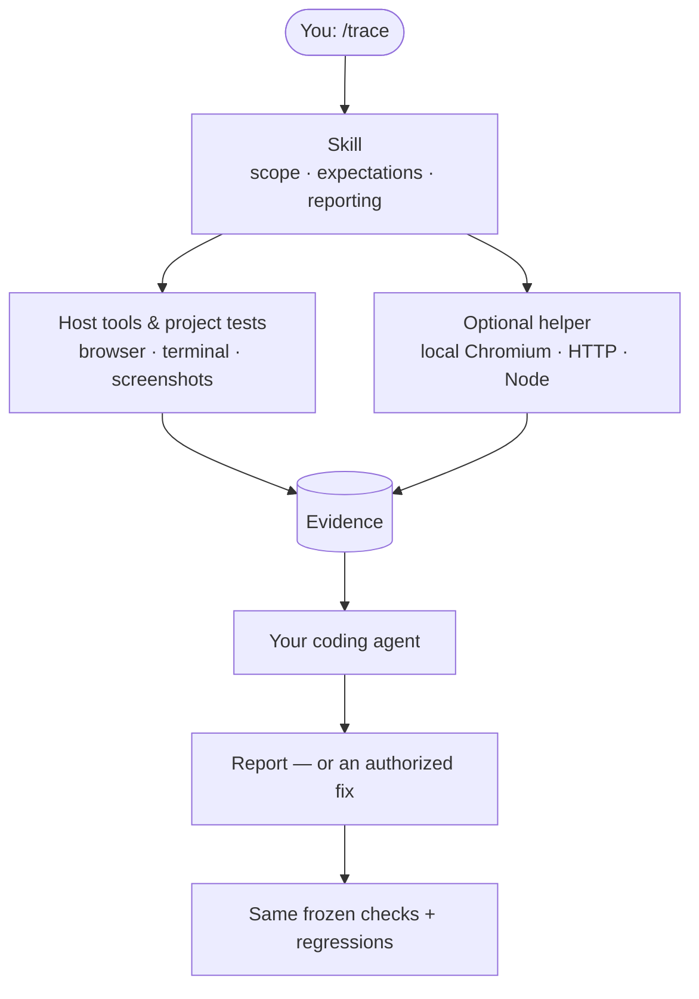
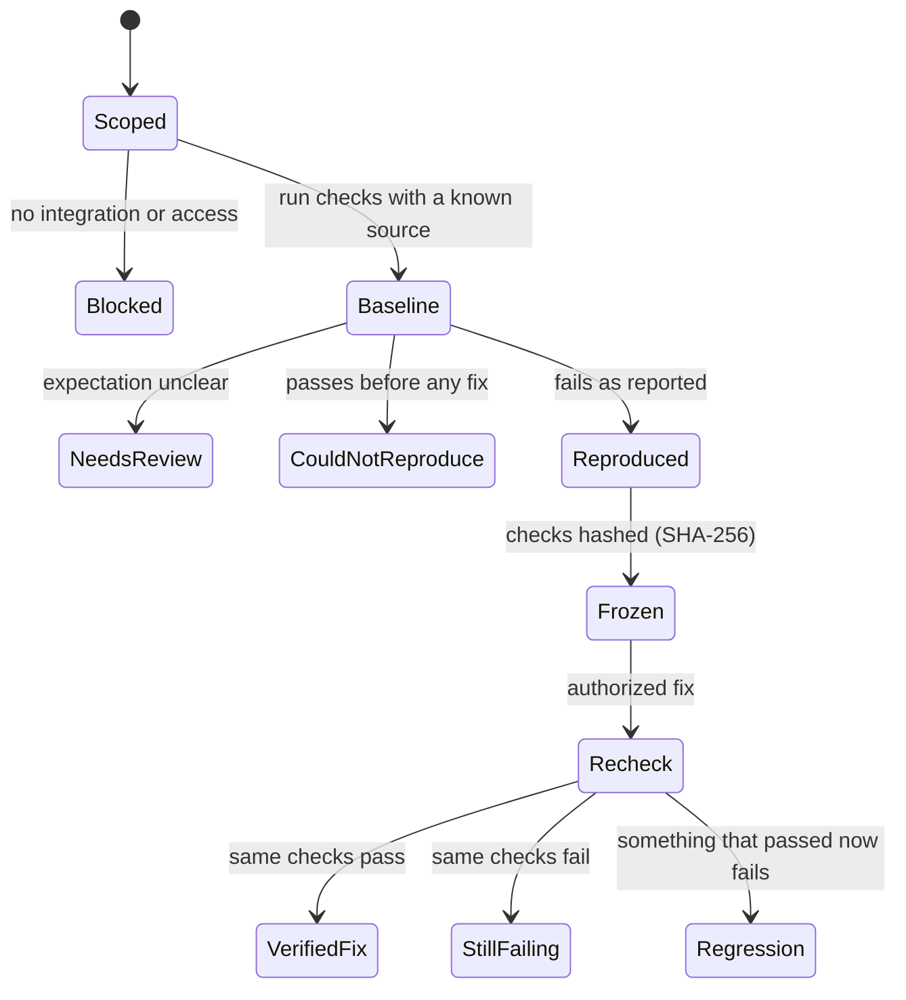

# 🏗️ Architecture

[← README](../README.md) · [Privacy](PRIVACY.md) · [Validation](VALIDATION.md)

TRACE is **not another agent**. It is a workflow that runs inside the coding agent you already use. The agent understands your project, your tools exercise the software, and an optional deterministic helper keeps bounded evidence and repeats exact checks.

## 🧩 The three parts

| Part | Responsible for | Deliberately not |
| --- | --- | --- |
| **Skill** · `skills/trace` | Choosing scenarios, picking tools, keeping evidence honest, the report format | A browser or mobile driver; a guarantee about what the model decides |
| **Plugins** · `.claude-plugin/` · `.codex-plugin/` · `hooks/` | Packaging the same skill and Stop hook for Claude Code and Codex, plus marketplace entries, settings and icons | Bundling the helper's browser or `node_modules` |
| **Installer** · `install.mjs` | Per-project install without a plugin: copies the skill, records file ownership, adds the opt-in auto-check hook | Global installs, package or browser downloads, overwriting your files |
| **Helper** · `src/` | Local browser flows and verification; HTTP, Node CLI and library checks | Other language runtimes, native drivers, an OS sandbox |

The main skill file is short. Detailed instructions for host tools, the helper and nonvisual checks live in `skills/trace/references/` and load only when needed. The installer writes `runtime.json` next to the skill. If its `cli` is `null`, the helper wasn't built, and the skill uses host tools only.

## 🔁 Evidence & verification lifecycle

- **The first run is the baseline.** A later pass only counts as a *verified fix* if the baseline failed. A pass with no earlier failure is *could not reproduce*.
- **Frozen checks can't drift.** If an expectation legitimately changes, it becomes a new check, and the old result stays visible. A hash detects changes but is not a signature against the file's owner.
- **Results carry history:** the number of runs and the time from the failing baseline to the verified fix.

With host tools, the agent keeps the same discipline by hand. It saves the scenario and expectations, hashes them, and repeats them unchanged. Host tools don't inherit the helper's browser isolation or masking.

## 🗄️ Helper evidence store

Evidence lives **outside the project**, in a per-user folder by default. Each incident has a manifest, an event timeline, the exact flow, a compact brief for the agent, screenshots, and an integrity index. Writes are atomic and paths are checked for symlinks. Raw and agent-approved copies are kept separate, and every omission (dropped events, blocked requests, failed steps) is recorded explicitly.

## 🗺️ Source map

| File | Responsibility |
| --- | --- |
| [`automatic.ts`](../src/automatic.ts) | Local app discovery, `inspect`/`run` flows, control and layout measurements |
| [`capture.ts`](../src/capture.ts) · [`observer.ts`](../src/observer.ts) | Network/console/runtime events, visible messages, masked screenshots, omission accounting |
| [`verify.ts`](../src/verify.ts) | Frozen oracles, flow replay, baseline-aware statuses, before/after screenshots |
| [`checks.ts`](../src/checks.ts) · [`node-probe.ts`](../src/node-probe.ts) | HTTP, Node CLI (including generated files) and library checks |
| [`store.ts`](../src/store.ts) · [`packet.ts`](../src/packet.ts) | Evidence integrity, approval and revocation, run history, compact briefs |
| [`browser-scope.ts`](../src/browser-scope.ts) · [`privacy.ts`](../src/privacy.ts) | Origin restriction and retained-data filtering |
| [`cli.ts`](../src/cli.ts) | Helper commands |
| [`auto-check.mjs`](../skills/trace/auto-check.mjs) · [`hooks.json`](../hooks/hooks.json) | Stop hook for task-boundary checks, shared by both plugins and the installer |
| [`.claude-plugin/`](../.claude-plugin/plugin.json) · [`.codex-plugin/`](../.codex-plugin/plugin.json) | Plugin manifests; marketplaces in `.claude-plugin/marketplace.json` and `.agents/plugins/marketplace.json` |

## 🔌 Adding an integration

A new integration is welcome when it actually works end to end. It needs:

1. a real way to operate **and** inspect the environment,
2. a bounded scenario with an identifiable expectation,
3. before/after verification using the same frozen checks,
4. a test that shows it reports a failure,
5. a stated permission boundary and a list of unsupported cases.

Until then, TRACE reports the area as **unsupported**. Native desktop/mobile drivers, a background daemon, a new MCP server and model-provider clients are intentionally absent. Hosts that already provide those can be used through the skill without adding another platform to TRACE.
