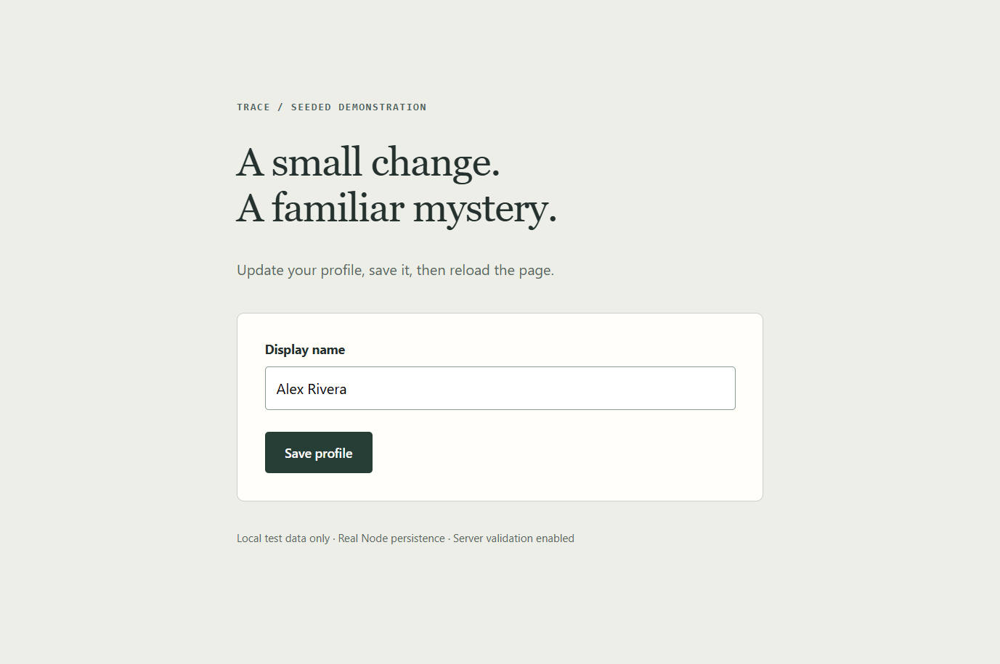

<div align="center">

# 🎬 The save that didn't save

**A seeded bug, caught, fixed and verified, using real screenshots.**

[← README](../README.md) · [Validation](VALIDATION.md) · [Profile contract](../examples/profile/README.md)

</div>

---

## The bug

A small profile app lets you change your display name. Its Node server saves the name to a JSON file and rejects invalid (**422**) or unauthorized (**403**) updates.

The broken client has two mistakes. It sends the wrong field name, and it shows **"Saved"** no matter what the server answers. That's a bug a coding agent can easily ship and swear is fine.

## What TRACE saw

| Before reload: false success | After reload: change lost |
| :---: | :---: |
|  |  |
| The UI says **Saved**. The server answered **PATCH 422**. | The field and `GET /api/profile` both still say `Alex Rivera`. |

TRACE filled the field, clicked **Save profile**, checked the PATCH response, reloaded, and read both the visible field and the API. **The screenshots alone were not trusted to prove anything.** The response status and the saved value back them up.

## After the fix


The working client ran on the same origin with the same data file. The **same four checks** were used:

| Check | Before | After |
| --- | :---: | :---: |
| After reload, the field shows `Mira Chen` | ❌ `Alex Rivera` | ✅ |
| `GET /api/profile` returns `Mira Chen` | ❌ `Alex Rivera` | ✅ |
| Empty name is rejected with 422 and nothing changes | ✅ | ✅ |
| Signed-out update is rejected with 403 and nothing changes | ✅ | ✅ |

The checks were frozen before the fix. Their SHA-256 never changed:

```text
2fd34d418c4e2fd96895a100df1c2ed684216f74d98e59ef2e0fc962ff5716a4
```

[Initial screen](assets/profile-initial.png) · [Frozen checks](native-criteria.json) · [Portable result](native-validation.json)

> [!NOTE]
> All data is synthetic. This demo shows that the tool path works on a **known, seeded** bug. It is not a benchmark of finding unknown bugs.

## Run it yourself

After the [development setup](../CONTRIBUTING.md#-setup):

```sh
npm run demo:proof -- capture   # broken app: reproduce and freeze the checks
npm run demo:proof -- after     # working app: same checks → verified
```

`capture` starts the broken app, runs the save → reload flow, freezes the four checks, and confirms the failure (`reproduced`). `after` switches to the working app on the same origin and re-runs the same checks (`verified within stated checks`). Each command stops the server it started.

Output goes to `.test-output/reproduction`. The evidence store and app data live outside the repo, in `../.trace-reproduction`. Set `TRACE_PROOF_OUTPUT` and `TRACE_PROOF_STORE` to new folders for a fresh run; existing output is never overwritten.

## Try it with your agent

```sh
npm run demo -- --broken     # http://127.0.0.1:5173
```

Then type `/trace check the local profile app` in your agent. Use `npm run demo` for the working version.

An independent Playwright test, which imports no TRACE code, checks the same contract:

```sh
npm run test:independent
```
